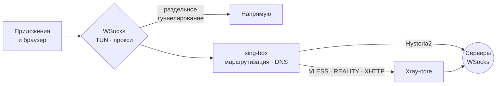

<div align="center">

<br>

```
██╗    ██╗███████╗ ██████╗  ██████╗██╗  ██╗███████╗
██║    ██║██╔════╝██╔═══██╗██╔════╝██║ ██╔╝██╔════╝
██║ █╗ ██║███████╗██║   ██║██║     █████╔╝ ███████╗
██║███╗██║╚════██║██║   ██║██║     ██╔═██╗ ╚════██║
╚███╔███╔╝███████║╚██████╔╝╚██████╗██║  ██╗███████║
 ╚══╝╚══╝ ╚══════╝ ╚═════╝  ╚═════╝╚═╝  ╚═╝╚══════╝
```

### Одна кнопка между вами и свободным интернетом

**WSocks для Windows** — VPN-клиент на гибридном ядре **sing-box + Xray-core**.<br>
Без драйверов, без ручных ключей, без лишних настроек.

<br>

[](https://github.com/WSocks-Develop/wsocks-client/releases/latest)
[](https://github.com/WSocks-Develop/wsocks-client/releases)


<br>

[**⬇ Скачать**](https://github.com/WSocks-Develop/wsocks-client/releases/latest) &nbsp;·&nbsp;
[**Сайт**](https://wsocks.shop) &nbsp;·&nbsp;
[**Telegram-бот**](https://t.me/WSocks_BOT)

<br>

</div>

---

<br>

## ◐ Идея

Большинство VPN-клиентов заставляют выбирать: **простота** или **контроль**.
WSocks не выбирает.

Для всех — большая кнопка питания, вход в аккаунт за пару секунд и подписки, которые подтягиваются сами.
Для тех, кто любит разбираться, — раздельное туннелирование, два режима работы, журнал ядра и собственный `config.json`.

> Вы нажимаете одну кнопку. Всё остальное — наша забота.

<br>

## ⚡ Возможности

<table>
<tr>
<td width="50%" valign="top">

### 🔑 Вход без ключей
Войдите через **Telegram** или **сайт wsocks.shop** — все ваши подписки появятся в клиенте автоматически. Никаких ключей, скопированных вручную.

</td>
<td width="50%" valign="top">

### 🧬 Гибридное ядро
**sing-box** отвечает за TUN, маршрутизацию и Hysteria2, **Xray-core** — за VLESS / REALITY / XHTTP. Каждый протокол работает на ядре, которое делает его лучше всего.

</td>
</tr>
<tr>
<td valign="top">

### 🔀 Раздельное туннелирование
Решайте, что идёт **мимо VPN**, а что — **только через него**:
- сайты, домены и IP-подсети
- доменные зоны целиком (`.ru`, `.рф`, `.su`)
- приложения — по `.exe` или прямо из списка запущенных программ

</td>
<td valign="top">

### 🛡 Два режима
- **TUN** — весь трафик системы идёт через VPN, включая игры и программы без поддержки прокси
- **Системный прокси** — лёгкий режим, SOCKS5 и HTTP на `127.0.0.1`

</td>
</tr>
<tr>
<td valign="top">

### 📡 Подписки и ключи
Ссылки `https://` на подписку, ключи `vless://` и `hysteria2://`, конфиги sing-box JSON. Вставьте текстом, загрузите из файла или **считайте QR-код прямо с экрана**.

</td>
<td valign="top">

### 📊 Статистика
Скорость в реальном времени, график за последние 60 секунд, трафик за сессию и за 7 дней, остаток по подписке и тест пинга всех серверов.

</td>
</tr>
<tr>
<td valign="top">

### 🚀 Автоподключение
Запуск вместе с Windows, тихий старт в трее и подключение к последнему или выбранному серверу — VPN готов раньше, чем вы о нём вспомните.

</td>
<td valign="top">

### 🔄 Обновления
Клиент сам проверяет новые версии на GitHub при запуске и раз в 6 часов, а подписки — обновляет в фоне.

</td>
</tr>
<tr>
<td valign="top">

### 💾 Резервные копии
Экспорт и импорт серверов, подписок, списков и настроек. Автокопия раз в неделю, хранятся три последние.

</td>
<td valign="top">

### 🌗 Дизайн
Единая дизайн-система WSocks, тёмная и светлая темы, аккуратные анимации — интерфейс, которым приятно пользоваться каждый день.

</td>
</tr>
</table>

<br>

## 🧠 Как это устроено



Клиент собирает конфигурацию на лету: **sing-box** поднимает TUN-интерфейс, разбирает трафик по правилам и решает, куда его отправить. Узлы VLESS обслуживает **Xray-core**, Hysteria2 — сам sing-box. Правила для приложений срабатывают раньше всех остальных, а наборы правил для российских доменов и IP подключаются автоматически, если в списке есть зоны `.ru` / `.рф` / `.su`.

<br>

## 📦 Поддерживаемые протоколы

| Протокол | Ядро | Формат |
|:--|:--:|:--|
| **VLESS + REALITY** | Xray-core | `vless://…` |
| **VLESS + XHTTP** | Xray-core | `vless://…` |
| **Hysteria2** | sing-box | `hysteria2://…` |
| **Подписка** | — | `https://…` |
| **Свой конфиг** | sing-box | `config.json` |

<br>

## 🚀 Быстрый старт

1. **Скачайте** `WSocksVPN-Windows-Setup-x.x.x.exe` из [последнего релиза](https://github.com/WSocks-Develop/wsocks-client/releases/latest).
2. **Установите** — для режима TUN нужны права администратора.
3. **Войдите** через Telegram или сайт — подписки добавятся сами. Или вставьте свой ключ.
4. **Нажмите кнопку.** Готово.

<details>
<summary><b>Системные требования</b></summary>
<br>

- Windows 10 / 11, x64
- Права администратора (для режима TUN)
- Всё остальное — ядра, наборы правил и среда выполнения — уже внутри установщика

</details>

<details>
<summary><b>Сборка из исходников</b></summary>
<br>

```bat
:: .NET 7 SDK + Inno Setup 6
scripts\build-installer.cmd
```

Установщик появится в `installer\Output\`. Порядок выпуска версии описан в [`installer/RELEASE.md`](installer/RELEASE.md).

</details>

<br>

---

<br>

<div align="center">

## WSocks VPN

**Быстрый и стабильный VPN-сервис, на котором работает этот клиент.**

Современные протоколы, которые сложно заблокировать · серверы в разных странах<br>
подписка для всех устройств · мы не храним журналы трафика

<br>

[](https://wsocks.shop)
&nbsp;
[](https://t.me/WSocks_BOT)

<br>

| 🌐 Сайт | 🤖 Telegram-бот | 💻 Клиент для Windows |
|:--:|:--:|:--:|
| [wsocks.shop](https://wsocks.shop) | [@WSocks_BOT](https://t.me/WSocks_BOT) | [Релизы](https://github.com/WSocks-Develop/wsocks-client/releases) |
| тарифы, оплата, личный кабинет | подписка, магазин, поддержка | этот репозиторий |

<br>

<sub>Сделано с ♥ командой WSocks</sub>

</div>
